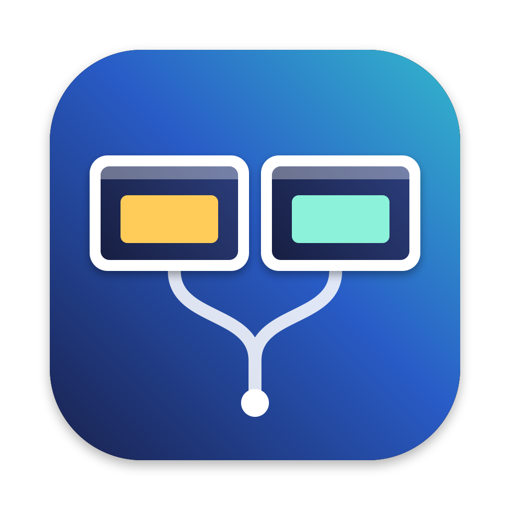

# TwinDesk

Two monitors from one cable on a Dell WD19 dock, on a Mac.

macOS does not support DisplayPort MST, so a Mac connected to a Dell WD19/WD19S dock shows the same picture on every monitor. TwinDesk is a menu-bar app that works around this using a feature of the dock's own video hub, and then makes macOS treat the two monitors as separate desktops.



> **Status: experimental.** Verified on exactly one Dell WD19S and one MacBook Air (M5, macOS 27). It relies on private macOS interfaces and on firmware behaviour Dell has since removed. Read [Risks](#risks) before using it, especially the firmware part.

## What it does

| Mode | What you get |
|---|---|
| **Mirror** | The dock's default: the same picture on both monitors. |
| **Wide** | One 3840×1080 desktop spanning both monitors. |
| **Twin** | Two separate 1920×1080 desktops, each with its own menu bar, Spaces and full-screen apps. |

It also restores your chosen mode when the dock reconnects or the Mac wakes, and it can back up, downgrade and upgrade the hub's firmware from its Setup window.

## How it works

1. **The hub does the splitting.** The dock contains a Synaptics VMM5331 MST hub. Its firmware has a mode ("ViewXpand") in which it advertises one combined display and sends the left half of the picture to one output and the right half to the other. TwinDesk switches that mode on by setting one byte in the hub's memory over the DisplayPort AUX channel, using Synaptics' vendor protocol.
2. **macOS sends one wide picture.** TwinDesk selects the native 3840×1080 mode, which macOS otherwise only offers scaled.
3. **Twin mode adds two virtual monitors.** TwinDesk creates two virtual 1080p displays, captures them with ScreenCaptureKit, and draws them side by side onto the physical wide display. macOS sees two monitors; the hub delivers each half to the right screen.

The research behind this, including why forcing MST from the Mac cannot work, is in [docs/](docs/).

## Requirements

- Apple Silicon Mac, macOS 14 or later (developed on macOS 27).
- Dell WD19-family dock with the Synaptics VMM5331 hub (WD19, WD19S; untested on the Thunderbolt variants).
- Two monitors with **identical timings** on the dock's DisplayPort outputs.
- **Hub firmware 05.07.04 or older.** Dell removed the split feature in 05.07.07. TwinDesk can install 05.07.04 for you (see below).

## Using it

1. Build and start the app (see [Building](#building)).
2. Open **Setup and firmware…** from the menu bar icon. It tells you whether your dock and firmware are supported.
3. Choose **Wide** or **Twin**. The first time after each dock reconnect, TwinDesk asks you to unplug and replug one monitor's cable at the dock; the hub only offers the wide display once a monitor is re-detected.
4. Twin mode needs **Screen Recording** permission (System Settings → Privacy & Security).

## Hub firmware

The Setup window can:

- **Back up** the hub's flash (always done automatically before any install).
- **Install 05.07.04**, the last version with the split feature.
- **Install 05.07.08**, to return to a current Dell version.

What an install does: downloads Dell's own firmware package from [LVFS](https://fwupd.org), checks it against a built-in SHA-256, writes the hub image to the hub's spare flash bank, verifies it by read-back and by the hub's checksum command, only then marks it valid and retires the old bank, and restarts the hub. Only the video hub is touched, never the dock's controller or USB hubs. The procedure follows [fwupd](https://github.com/fwupd/fwupd)'s Synaptics and Dell dock plugins; details and open questions are in [docs/flasher.md](docs/flasher.md).

The same operations are available from the command line:

```
twindeskctl status
twindeskctl mode wide|mirror
twindeskctl fw state | backup | checksum | flash --cab <dell.cab> [--write] [--rc-reboot]
```

`fw flash` is a dry run unless `--write` is given.

## Risks

- **Firmware writes can break your dock.** An interrupted or failed write can leave the dock without video output. The flasher has completed an upgrade and a downgrade on one WD19S. That is all the evidence there is.
- **Older firmware means missing fixes.** Dell's later hub versions include fixes you give up by running 05.07.04, and any Dell dock update will remove the split feature again.
- **Private interfaces.** TwinDesk uses undocumented macOS calls (`IODPDevice`, `CGVirtualDisplay`, CoreGraphics display-mode services). Any macOS update can break it.
- **Twin mode trade-offs.** One to two frames of added latency, copy-protected video shows as black, 60 Hz at 1× only, and a hidden third display remains in the arrangement.
- No warranty of any kind. Not affiliated with Dell, Synaptics or Apple.

## Building

Needs only the Xcode Command Line Tools.

```
swift build                      # libraries and twindeskctl
./scripts/build-app.sh           # dist/TwinDesk.app (release, ad-hoc signed)
./scripts/build-app.sh --dev     # development build, see below
```

macOS ties the Screen Recording permission of an ad-hoc signed app to the exact binary, so every rebuild of `TwinDesk.app` loses it. The `--dev` build avoids that: `dist/TwinDesk Dev.app` is a tiny fixed launcher that loads the freshly built app code from `dist/libTwinDeskDev.dylib`.

Tests for the firmware module (the Command Line Tools lack XCTest, hence the extra flags):

```
swift test --filter FirmwareKitTests \
    -Xswiftc -plugin-path -Xswiftc /Library/Developer/CommandLineTools/usr/lib/swift/host/plugins/testing
```

Tests that need real firmware images are skipped unless you provide them (`TWINDESK_FWDUMP_DIR`, `TWINDESK_CAB_DIR`).

## Layout

| Path | Contents |
|---|---|
| `Sources/CDock` | C: DisplayPort AUX access, Synaptics vendor protocol, guarded firmware primitives, display-mode selection |
| `Sources/DockKit` | Swift wrapper: dock detection, state, mode switching |
| `Sources/TwinKit` | Twin mode: virtual displays, capture, output window |
| `Sources/FirmwareKit` | Package verification, backup, flash planning and execution, simulator |
| `Sources/TwinDeskApp`, `Sources/TwinDesk` | Menu-bar app and Setup window |
| `Sources/twindeskctl` | Command-line tool |
| `docs/` | Firmware procedure and research notes |

## Credits

- [fwupd](https://github.com/fwupd/fwupd) for the Synaptics MST and Dell dock update logic.
- [kksimp/wd19-split](https://github.com/kksimp/wd19-split) for first documenting the ViewXpand mode byte on the WD19.

## Licence

LGPL-2.1-or-later (see [LICENSE](LICENSE)); the firmware module derives from fwupd, which uses the same licence.
